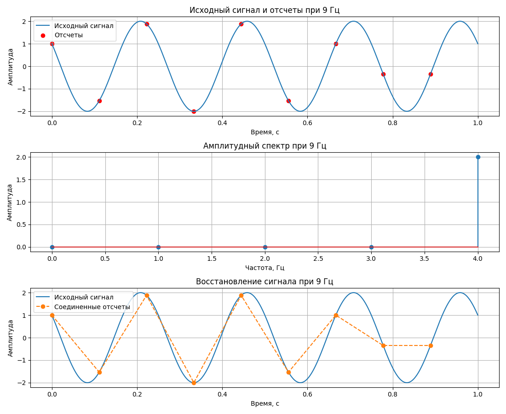
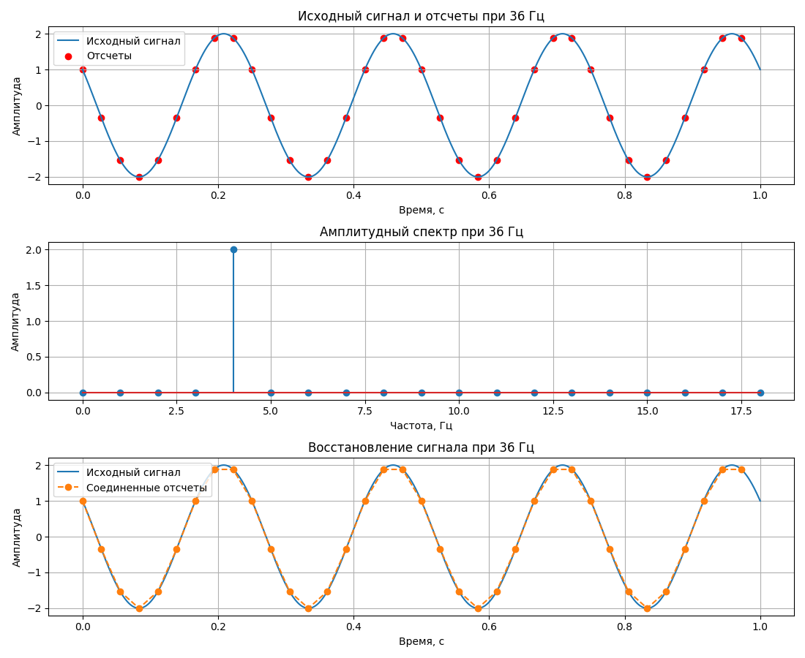
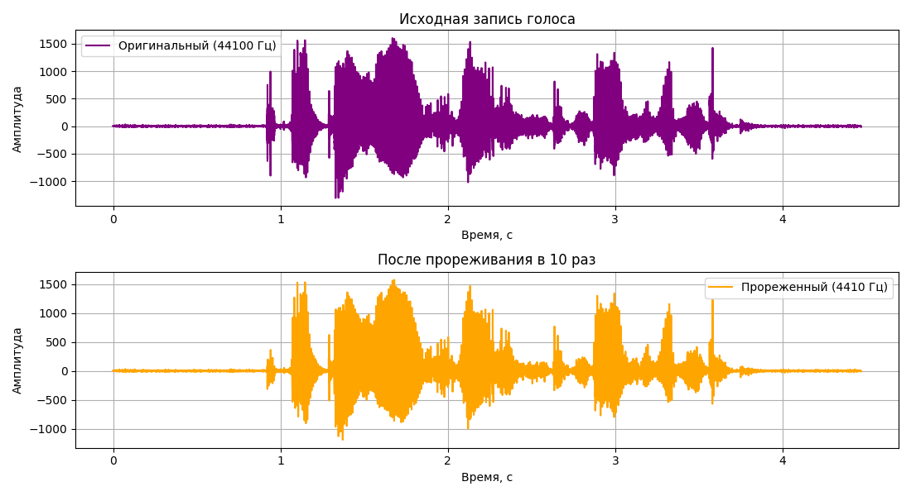
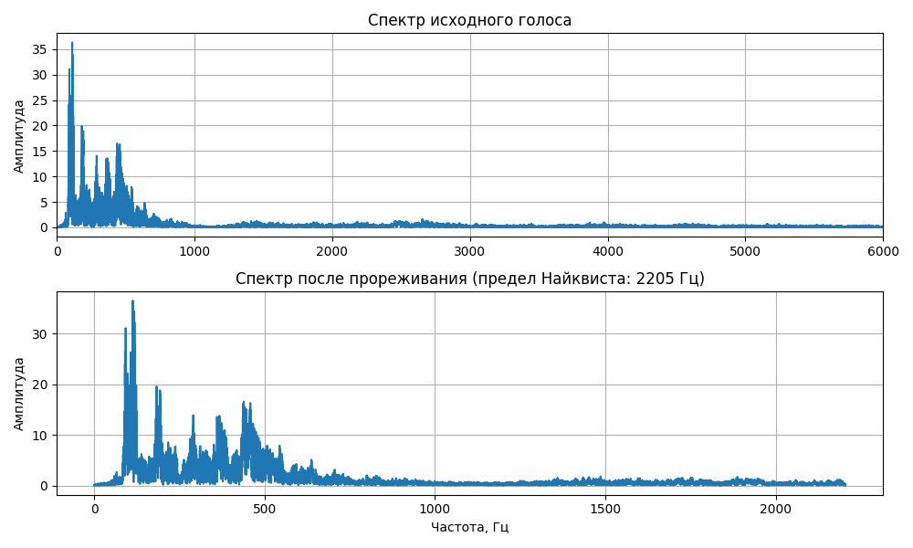
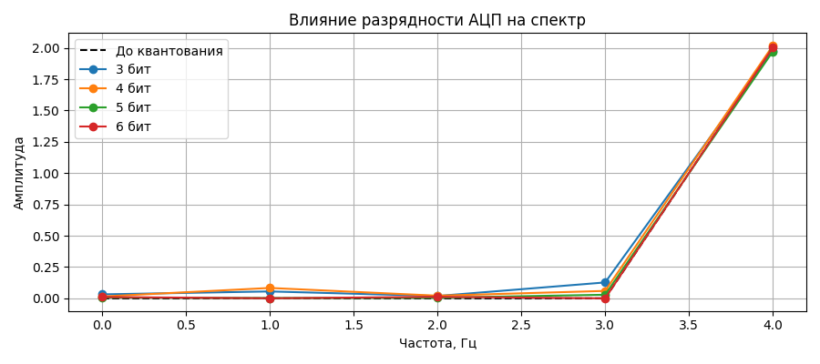

# Лабораторная работа №1

**Тема:** Временная и частотная формы сигналов.
Преобразования Фурье. Дискретизация сигналов.

**Вариант:** 2

## Цель работы

Изучение методов дискретизации, спектрального
анализа и квантования сигналов.

## 1. Исследование гармонического сигнала

Исходная функция:

y(t) = 2cos(8πt + π/3)

Параметры:
- Амплитуда: 2
- Частота: 4 Гц
- Период: 0,25 с
- Начальная фаза: π/3

По теореме Котельникова частота дискретизации
должна превышать 8 Гц.

### Дискретизация с частотой 9 Гц

### Увеличение частоты до 36 Гц

При увеличении частоты дискретизации число
отсчётов увеличилось с 9 до 36.
Линейная интерполяция стала точнее
приближать исходный сигнал.

## 2. Исследование голосового сигнала

Была записана голосовая дорожка в формате WAV.

Параметры исходной записи:
- Частота дискретизации: 44100 Гц
- Продолжительность: около 4,47 с

Проведено прореживание с коэффициентом 10.
Новая частота дискретизации составила 4410 Гц.

### Временные реализации

### Амплитудные спектры

После прореживания верхняя частота,
которую можно однозначно представить
без наложения спектров, снизилась до 2205 Гц.

## 3. Квантование сигнала

Выполнено равномерное квантование
исходного сигнала с разрядностью 3–6 бит.

Для каждой разрядности вычислена
средняя абсолютная ошибка квантования.

При увеличении разрядности уменьшается
шаг квантования и ошибка представления
амплитуды сигнала.

## 4. Запуск программы

Используемые библиотеки:
- NumPy
- SciPy
- Matplotlib

Установка библиотек:

    pip install numpy scipy matplotlib

Запуск:

    python remake_lab1.py

Для анализа голоса необходимо положить
собственный WAV-файл с названием
OSM_lab1.wav рядом с программой.

## Вывод

В работе исследованы дискретизация,
спектральное представление, прореживание
и квантование сигналов.

Увеличение частоты дискретизации позволяет
получить больше отсчётов сигнала.

Прореживание без предварительной фильтрации
может вызвать наложение спектров.

Увеличение разрядности АЦП позволяет
уменьшить ошибку квантования.
